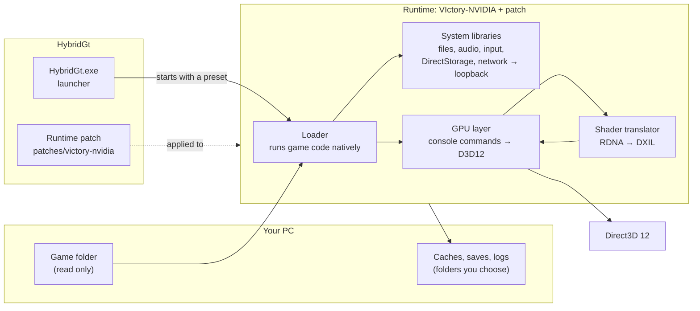

# HybridGt

A launcher, a runtime patch set and an open measurement record for running the **Xbox Series X|S
build of Grand Theft Auto VI on Windows PCs**, natively and offline, from your own copy of the game.

[](https://discord.gg/g6FZ9XwW8j) .
[](LICENSE)
[](docs/WINDOWS_COMPATIBILITY.md)
[](docs/dev/DEVELOPMENT.md)
[](docs/dev/SHADER_TRANSLATION.md)
[](docs/PERFORMANCE.md)
[](docs/PERFORMANCE.md#test-system)

[**Download**](https://github.com/LowBacon/HybridGt/releases/latest) ·
[Discord Community](https://discord.gg/g6FZ9XwW8j) .
[Getting started](#getting-started) ·
[Architecture](docs/dev/ARCHITECTURE.md) ·
[Shader translation](docs/dev/SHADER_TRANSLATION.md) ·
[Performance](docs/PERFORMANCE.md) ·
[Known issues](docs/KNOWN_ISSUES.md) ·
[Troubleshooting](docs/user/TROUBLESHOOTING.md) ·
[Contributing](CONTRIBUTING.md) ·
[All documentation](docs/README.md)

> [!IMPORTANT]
> HybridGt contains no game files and never modifies, uploads or redistributes them. You need your own
> copy of the game's Xbox Series files. HybridGt doesn't bypass DRM, encryption or licensing.

## Contents

- [About](#about)
- [How it works](#how-it-works)
- [Development status](#development-status)
- [Performance](#performance)
- [Compatibility](#compatibility)
- [Getting started](#getting-started)
- [Documentation](#documentation)
- [Known limitations](#known-limitations)
- [Contributing](#contributing)
- [Credits](#credits)
- [Disclaimer and license](#disclaimer-and-license)

## About

Xbox Series consoles use an x86-64 AMD processor, the same kind of processor a PC has. So the game's
own machine code can run on a PC directly, without emulating a CPU. What a PC doesn't have is the
console's operating system and its GPU. A **runtime** fills that gap. It loads the game's executable,
answers its calls into the console's system libraries, and translates its graphics work, both
commands and shaders, to **Direct3D 12**.

HybridGt doesn't write that runtime from scratch. It builds on
[VIctory-NVIDIA](https://github.com/pepezin-ai/VIctory-NVIDIA) (pepezin-ai), which is built on
[foxhound](https://github.com/readmet3xt-lab/foxhound) (readmet3xt-lab), itself a fork of
[VIctory](https://github.com/Marvisak/VIctory) (Marvisak). HybridGt contributes three things:

| | |
|---|---|
| **The launcher** | `HybridGt.exe`, one file. It finds your game and the runtime, prepares shader and pipeline caches, starts the game with a tested preset, and reports problems in plain words. |
| **The runtime patch** | HybridGt's changes on top of VIctory-NVIDIA: a stand-in for the game's AMD FSR 3.1 calls (used only when you point it to AMD's PC files), the mouth-animation fix, validator and level-of-detail fixes, a sound delay, offline shader tests. Kept as one reviewable diff: [patches/victory-nvidia](patches/victory-nvidia/README.md). |
| **The measurement record** | Changes are measured on a real PC, including the ones that didn't help; what isn't measured yet is marked *not yet measured*. Progress figures are counts or measurements, never estimates. |

**Scope today:** one game build (v1.0.2.1), Windows 10/11 x64, Direct3D 12 GPUs with mesh shaders.
Verified on NVIDIA; AMD is expected to work but hasn't been tested.

### What is new in 0.3.0

The runtime base moved from VIctory-NVIDIA `9d6300fa` to `df2daafe`, 50 upstream commits newer. The
HybridGt patch was carried over as 9 commits
([COMMITS-df2daafe.txt](patches/victory-nvidia/COMMITS-df2daafe.txt)).

| Change | From | State |
|---|---|---|
| In-game **F1 settings menu** and **F3 stats panel**. The F1 menu reads *HYBRIDGT SETTINGS* and credits VIctory-NVIDIA. | Upstream; HybridGt title | F3 seen in game; HybridGt title not yet seen in game |
| **NVIDIA DLSS** Super Resolution and Frame Generation through NVIDIA Streamline | Upstream | DLSS seen taking the game's upscales; frame generation seen at 2x |
| **AMD FSR 3 frame generation** for cards without DLSS Frame Generation | Upstream | Not yet seen in game |
| MFG Unlocker option (someone else's MIT mod, for RTX 20/30, off by default) | Upstream | Tried by the tester; see [Performance](#performance) |
| Upstream fixes: open water without dark blocks, "confetti on faces", ambient probe purple blotch, BC7 rotation, raw buffer views clamped | Upstream | Not yet checked one by one in game |
| PS5 DualSense input, fullscreen/mouse/IME window options, optional Bink skip, `victory play` | Upstream | Not yet seen in game, except `victory play` |
| **Crash fix:** a divide by zero in the game's code about 50 s after loading a save | HybridGt | Fixed; a session ran about 12 minutes past the old crash point |
| F1 menu settings are kept across `victory play`'s first-start restart | HybridGt | Fixed |
| Launcher **Performance** preset: DLSS Quality and frame generation 2x where NVIDIA's files are, worker pools by CPU count (16+ logical CPUs), placed order, High priority | HybridGt | Not yet measured by HybridGt |
| Launcher **Get NVIDIA DLSS**, **Get AMD FSR 3**, **Get MFG Unlocker (mod)** buttons | HybridGt | Download only when pressed |
| The launcher starts and picks only HybridGt's own runtimes | HybridGt | Unit-tested |

The crash: HybridGt's FidelityFX module used to stand in for the game's upscaler even without AMD's
PC files. The game's upscaler then failed, DLSS saw no upscaler to replace, and the game divided by
zero. The module now loads only when `VICTORY_FFX_DIR` names a folder with
`amd_fidelityfx_loader_dx12.dll` and `amd_fidelityfx_upscaler_dx12.dll`. Details:
[What the HybridGt patch changes](docs/dev/ARCHITECTURE.md#what-the-hybridgt-patch-changes) and the
[Changelog](CHANGELOG.md).

## How it works



| Component | Origin | Role |
|---|---|---|
| Loader, system libraries, GPU layer, shader translator | VIctory → foxhound → VIctory-NVIDIA (upstream) | Running the game: see [ARCHITECTURE.md](docs/dev/ARCHITECTURE.md#the-runtime) |
| FidelityFX (FSR 3.1) stand-in, sound delay, mouth fix, validator and LOD fixes, heap-descriptor reads, offline tests, F1 menu title | **HybridGt** patch | See [What the HybridGt patch changes](docs/dev/ARCHITECTURE.md#what-the-hybridgt-patch-changes) |
| Launcher | **HybridGt** | Setup, presets, diagnostics: see [LAUNCHER.md](docs/LAUNCHER.md) |

Most of the work per frame isn't the GPU's. A console's CPU and GPU share one memory, while a PC has
two, so the runtime spends most of each frame keeping copies of the game's memory on the graphics
card. That is why the frame rate is CPU-bound today ([PERFORMANCE.md](docs/PERFORMANCE.md)).

## Development status

<sub>Every figure below is a count from an offline run or a measurement from a game session on the
[test system](docs/PERFORMANCE.md#test-system). Items marked *earlier runtime* were measured before
the move to VIctory-NVIDIA.</sub>

[](docs/STATUS.md)

<sub>The shader figures in the image (marked *current runtime*) were measured on the `9d6300fa` build;
re-checked on `df2daafe` on 2026-11-28: the same counts.</sub>

**Runtime:** VIctory-NVIDIA `df2daafe` plus the HybridGt patch
([hybridgt-on-victory-nvidia-df2daafe.patch](patches/victory-nvidia/hybridgt-on-victory-nvidia-df2daafe.patch),
9 commits, 32 files), the default from 0.3.0. VIctory-NVIDIA has been the default since 0.2.0; the
patch on `9d6300fa` stays in the repository for reference. The earlier runtime remains available as
the *Classic* preset.

**Shader translation** (offline, 2026-11-27, for a 32-lane NVIDIA GPU; measured on the `9d6300fa`
build, re-checked on `df2daafe` on 2026-11-28: the same counts):

| Stage | Programs | Pass Microsoft's DXIL validator |
|---|---:|---:|
| Vertex and pixel | 14,247 | **14,247 (100 %)** |
| Mesh | 8,765 | 8,694 (99.2 %) |
| Compute | 2,682 | 2,659 (99.1 %) |
| Geometry | 195 | 0 |
| **All** | **25,889** | **25,600 (98.9 %)** |

The remaining 289 programs, why each fails and what it takes, are listed in
[SHADER_TRANSLATION.md](docs/dev/SHADER_TRANSLATION.md#what-is-left-and-why).

**Milestones:**

| Date | Milestone |
|---|---|
| 2026-11-24 | First 3D world on an RTX 4070 Ti (0.4 fps) |
| 2026-11-26 | Whole characters, lit interiors, AMD FSR 3.1.6 in game (earlier runtime) |
| 2026-11-27 | Runtime moved to VIctory-NVIDIA: **14.2 fps median**, 5.6 GB graphics memory |
| 2026-11-27 | Every vertex and pixel program passes Microsoft's validator; launcher 0.3.0 built and tested offline |
| 2026-11-28 | Runtime moved to VIctory-NVIDIA `df2daafe`: F1 menu, F3 panel, DLSS and frame generation in game |
| 2026-11-28 | Crash about 50 s after loading a save fixed; a session ran about 12 minutes past the old crash point |

**Tests:** runtime suite on the `9d6300fa` build: 1,031 of 1,032 pass (one upstream test fails only
when tests run in parallel, and passes alone). On the `df2daafe` build: 1,078 passed, 0 failed, 52 ignored (2026-11-28). Launcher: 34 unit
tests pass.

Every problem's progress, from *found* to *seen fixed in game*, is tracked in
[STATUS.md](docs/STATUS.md). What comes next is in [ROADMAP.md](docs/ROADMAP.md).

## Performance

Measured on an RTX 4070 Ti 12 GB, Ryzen 7 5800X3D and 32 GB RAM, Windows 11.

**Same-route measurement (2026-11-27, VIctory-NVIDIA `9d6300fa` base).** Both runtimes ran the same
scripted open-world route back to back, with caches warmed. The game rendered at 1440p and upscaled
to 4K with its own temporal upscaler.

| Runtime | Median fps | Best | 10th percentile | Median frame time | Graphics memory |
|---|---:|---:|---:|---:|---:|
| Earlier runtime (now *Classic*) | 5.8 | 7.4 | 1.9 | 174 ms | 9.2 GB |
| **VIctory-NVIDIA `9d6300fa` + HybridGt (the default at the time)** | **14.2** | **18.0** | **3.5** | **70 ms** | **5.6 GB** |

[](docs/PERFORMANCE_OPTIMIZATION.md)

- **Median fps** is the typical speed: half the measured seconds were faster.
- **10th percentile** is the speed the slowest tenth of seconds stayed under. True 1 % lows weren't
  measured, because the runtime logs once a second.
- Menus and videos run at the game's own 30 fps.
- **The bottleneck is the CPU side:** copying and checking the game's memory for the GPU, not the GPU itself.

**Indicative readings (2026-11-28, `df2daafe` base).** These were not a same-route back-to-back
benchmark, so they can't be compared directly with the table above.

| Session | Reading |
|---|---|
| Upstream `df2daafe` build as downloaded, DLSS and frame generation on (the tester's own session) | World median 13.2 fps, 10th percentile 10.2, 90th percentile 16.6, over 441 world seconds. The "20 fps" remembered was the best moments. |
| Merged HybridGt build, an interior, while pipelines were still being made (about 290 draws a frame skipped) | 17.3–17.9 fps per-second readings |
| Merged build, F3 panel, the same interior, frame generation off | 12.8 fps, 77.9 ms a frame, longest 103 ms. The runtime's submitting thread is busy 65.7 ms a frame; the GPU is busy 37.5 ms and idle 35.6 ms waiting for the runtime. Copy-back of what the GPU wrote: 16.5 ms. VRAM 7.7 of 11.0 GB plus 6.0 GB shared; RAM 23.1 GB. |

- **Frame generation** shows extra frames; it doesn't raise the game's own rate, and generated frames
  guess motion. On the RTX 4070 Ti, DLSS Frame Generation runs at 2x (the runtime reports *MORE THAN
  2X NEEDS AN RTX 50 CARD*). With 6x through the MFG Unlocker the tester saw 80–100+ fps shown, while
  cars looked and handled oddly when driving.
- The F3 figures show the same limit as before: preparing the game's memory for the GPU and copying
  it back, on the CPU side.

**Not yet measured:** a same-route benchmark on `df2daafe`, the Performance preset (upstream measured
its worker-pool and placed-order tuning at +22–29 % in heavy scenes on an RTX 4070 SUPER), FSR 3.1 and
FSR 3 frame generation on the current runtime, the launcher's memory modes and frame caps, AMD GPUs.
**Target:** 30 fps in the world; not reached. Method, frame breakdown and how to report a benchmark:
[PERFORMANCE.md](docs/PERFORMANCE.md).

## Compatibility

| Category | Meaning |
|---|---|
| **Verified** | Seen working in a game session on the test system |
| **Partially working** | Works, with a visible flaw |
| **Experimental** | Available behind a preset or switch, not verified on the current runtime |
| **Not implemented** | No path exists yet |
| **Known issue** | Reproducible problem under investigation |

| Area | State | Notes |
|---|---|---|
| Boot, menus, videos | Verified | 30 fps |
| Open world | Verified | 14.2 fps median (2026-11-27, `9d6300fa`); merged `df2daafe` build: not yet measured in the world (upstream's own build read 13.2 median, indicative) |
| Characters, interiors | Verified | Interiors use an estimate of the game's traced light |
| Saves | Verified | One saves folder per runtime. The save body is encrypted; HybridGt doesn't edit saves. |
| F1 settings menu, F3 stats panel | Verified | F3 read in game. Started through `victory play`, F1 settings are saved in the home folder (`VICTORY_HOME`); keeping it across the first-start restart is fixed, not yet seen in game |
| Boats, first boat mission | Verified (earlier runtime) | Seen by the tester on the Classic runtime; not yet replayed on the current one |
| Cutscenes | Partially working | Eyes and close-ups can look wrong while textures load |
| Textures | Known issue | Black or late when graphics memory is full, more often with frame generation on: [KNOWN_ISSUES.md](docs/KNOWN_ISSUES.md#rendering) |
| Reflections | Known issue | The runtime doesn't build the game's ray-tracing structures, so reflection rays get the sky light. The runtime's estimate replaces it on opaque surfaces only; glass shows a cyan sparkle; floors keep grainy reflection noise. |
| White screen while driving | Known issue | Sometimes, fading slowly. Suspected: DLSS history after a bad frame; not confirmed. To test: F1 → DLSS off. |
| First minutes of a new area | Partially working | Draws are skipped until their pipelines are made; `victory warm` makes them ahead (about 35 minutes, game closed) |
| Mouth animation | Partially working | The #927 fix was seen working on the earlier runtime. On the current runtime it is ported but not yet seen, and mouths trail the voice at low fps (Settings → Sound delay). |
| Water | Known issue | Dark pixels on the earlier base; upstream's open-water fix is in `df2daafe`, not yet checked in game by HybridGt |
| NVIDIA DLSS Super Resolution | Verified | Takes the game's upscales in game (log count). The white screen while driving may come from it (suspected, not confirmed) |
| NVIDIA DLSS Frame Generation | Partially working | 2x on an RTX 4070 Ti; generated frames guess motion. With 6x through the MFG Unlocker, cars looked and handled oddly |
| AMD FSR 3 frame generation | Experimental | For cards without DLSS Frame Generation; not yet seen in game |
| AMD FSR 3.1 (game's upscaler stand-in) | Experimental | Verified on the earlier runtime (FSR 3.1.6). Now used only when `VICTORY_FFX_DIR` holds AMD's two PC DLLs; not yet run on this runtime |
| The game's ray tracing | Experimental | Ray tracing and All in one presets |
| Voxelized lighting (geometry stage) | Not implemented | 195 programs |
| Xbox controllers, keyboard | Verified | Keyboard: Enter = A, Esc = Menu, W A S D = left stick |
| PS5 DualSense | Experimental | Upstream support; not yet seen in game |
| NVIDIA RTX 40 | Verified | RTX 4070 Ti |
| AMD Radeon | Not verified | Expected to work; see [WINDOWS_COMPATIBILITY.md](docs/WINDOWS_COMPATIBILITY.md#graphics-cards) |

**How compatibility is tested:**
- *Offline*: every shader is translated and validated, and the unit and GPU tests are run (WARP, the
  software renderer, and the hardware GPU).
- *In game*: benchmarks on the test system follow a fixed route; other sessions (such as the
  2026-11-28 readings) are labelled indicative, and a tester reports what is seen.
- An item is *Verified* only after a game session. Offline results alone stay *Experimental*.

## Getting started

### Requirements

| | |
|---|---|
| OS | Windows 10 version 2004 (build 19041) or later, x64. Tested on Windows 11. |
| GPU | Direct3D 12 with mesh shaders and Shader Model 6.6, 8 GB or more. Tested: RTX 4070 Ti 12 GB. |
| RAM | 32 GB recommended (tested) |
| Disk | About 20 GB free for shader and pipeline caches, preferably on an SSD |
| Libraries | Microsoft Visual C++ 2015–2022 Redistributable (x64) |

Details: [WINDOWS_COMPATIBILITY.md](docs/WINDOWS_COMPATIBILITY.md).

### Using the release

1. Download `HybridGt.exe` from [Releases](https://github.com/LowBacon/HybridGt/releases/latest) into
   a folder of its own. Settings are saved beside it.
2. Start it. It scans your drives for the game folder, the runtime, caches and saves (about half a
   minute). You can also set them under **Settings**.
3. Optional: under **Settings**, press **Get NVIDIA DLSS** (RTX cards), **Get AMD FSR 3**, or **Get
   MFG Unlocker (mod)**. Each runs the runtime's own `get-dlss`, `get-fsr` or `get-mfg`, which fetches
   from NVIDIA's, AMD's or the mod author's own GitHub (AMD's files and the MFG Unlocker are checked
   against SHA-256; NVIDIA's against the sizes in NVIDIA's archive). The launcher itself has no network
   code. The runtime downloads only when you ask: a Get button, `victory get-…`, or turning on
   F1 > MFG UNLOCKER (fetched at the next start).
4. Open **Diagnostics** and check that every requirement reads *ok* or *optional*.
5. On **Home**, press **INITIALIZE**. It runs eight steps (dependencies, game files, configuration,
   shader cache, pipeline cache, assets, compatibility, integrity), each with its result and reason.
6. Press **PLAY**. In game, **F1** opens the settings menu and **F3** the stats panel. After your
   first session, run INITIALIZE again so the pipeline step makes the recorded pipelines ahead of time.

### Building from source

```powershell
git clone https://github.com/LowBacon/HybridGt
cd HybridGt
cargo build --release -p hgt-launcher
```

```powershell
cargo test --release -p hgt-launcher
```

These need the Rust MSVC toolchain (1.88+) and the Windows SDK. The runtime is built from VIctory-NVIDIA
`df2daafe` with `patches/victory-nvidia/hybridgt-on-victory-nvidia-df2daafe.patch` applied. Every step, every test command and the offline shader
check are in [DEVELOPMENT.md](docs/dev/DEVELOPMENT.md).

### Configuration

The launcher passes folders and switches to the runtime as environment variables, so nothing is
written into the game folder. Every preset except Classic starts through `victory play`, so the F1
menu's settings are saved and applied at each start; they live in HybridGt's home folder,
`%LOCALAPPDATA%\HybridGt\home`. Settings the F1 menu owns (DLSS, frame generation, frame cap, Series S
profile) are passed as `victory play` options, so what you change in F1 wins. The launcher starts and
picks only HybridGt's own runtimes: it reads the file for HybridGt's markers, without running it.

NVIDIA's DLSS files and AMD's FSR 3 files aren't included. Use the **Get** buttons above, or run
`tools\vendor\Get-NVIDIA-DLSS.cmd` or `Get-AMD-FSR.cmd` (VIctory-NVIDIA's download scripts, unchanged;
the two .cmd wrappers are adapted to put the files under `%LOCALAPPDATA%\victory`). The
launcher's scan finds the files in HybridGt's home, `%LOCALAPPDATA%\victory`, or a runtime checkout
([details](tools/vendor/README.md)). Presets and settings are documented in [LAUNCHER.md](docs/LAUNCHER.md).
Memory modes are explained in [GPU_MEMORY.md](docs/GPU_MEMORY.md).

| Preset | Inside resolution | Upscaling | Status |
|---|---|---|---|
| **Fast** (default) | 1440p (Series X profile) | DLSS Quality where NVIDIA's files are found (F1 can turn it off), otherwise the game's own | Measured on `9d6300fa` with the game's own upscaler: 14.2 fps median; with DLSS on `df2daafe` not yet measured |
| Performance | 1440p (Series X profile) | DLSS Quality and frame generation 2x, where NVIDIA's files are | Worker pools by CPU count (16 or more logical CPUs), placed order, High priority. Upstream measured this tuning at +22–29 % in heavy scenes on an RTX 4070 SUPER. Not yet measured by HybridGt |
| Series S + FSR 3.1 | 720p (Series S profile) | AMD FSR 3.1 → 1080p, when you set the folder with AMD's PC DLLs | Experimental on this runtime |
| All in one | 720p (Series S profile) | AMD FSR 3.1, as above | Experimental: adds the game's ray tracing |
| Ray tracing | 1440p (Series X profile) | DLSS Quality where NVIDIA's files are found (F1 can turn it off), otherwise the game's own | Experimental |
| Classic | The game's choice | The game's own | The earlier runtime, with its own saves; started without `victory play` |

### Troubleshooting

The launcher's **Diagnostics** page is the first stop. Common cases (a black first run, saves that
don't load, a blocked setup step, memory pressure, mouths out of sync) are covered in
[TROUBLESHOOTING.md](docs/user/TROUBLESHOOTING.md).

> [!NOTE]
> Game-specific setup stays on your machine. Where your copy comes from, and your right to use it, is
> your responsibility. HybridGt's documentation only refers to the folder you point it to.

## Documentation

| For | Documents |
|---|---|
| Players | [Troubleshooting](docs/user/TROUBLESHOOTING.md) · [Launcher](docs/LAUNCHER.md) · [Windows compatibility](docs/WINDOWS_COMPATIBILITY.md) · [GPU memory](docs/GPU_MEMORY.md) · [Known issues](docs/KNOWN_ISSUES.md) |
| Developers | [Architecture](docs/dev/ARCHITECTURE.md) · [Shader translation](docs/dev/SHADER_TRANSLATION.md) · [Development](docs/dev/DEVELOPMENT.md) · [NVIDIA and 64-lane waves](docs/NVIDIA_WAVE64_COMPATIBILITY.md) · [Contributing](CONTRIBUTING.md) |
| Status | [Performance](docs/PERFORMANCE.md) · [Status of every fix](docs/STATUS.md) · [Roadmap](docs/ROADMAP.md) · [Run log](docs/PERFORMANCE_OPTIMIZATION.md) · [Changelog](CHANGELOG.md) |

The full index is in [docs/README.md](docs/README.md).

## Known limitations

- **Frame rate.** 14.2 fps median in the open world on the `9d6300fa` build (13.2 on upstream's
  `df2daafe` build, indicative; HybridGt's merged build not yet measured in the world), bound by the CPU side: preparing the game's
  memory for the GPU and copying back what it wrote. The target is 30; not reached. Frame generation
  shows more frames but doesn't raise the game's own rate.
- **Rendering.** Reflections are wrong: rays get the sky light, glass shows a cyan sparkle, floors
  keep grainy noise. A white screen sometimes appears while driving and fades slowly (cause not
  confirmed). Textures can arrive late, black, or in the wrong colour. Some descriptor views past
  Direct3D 12's 1,000,000-view cap read an empty slot, a likely cause of wrong-looking eyes. Draws are
  skipped until their pipelines are made (`victory warm` makes them ahead). Upstream's open-water fix
  is not yet checked in game.
- **Shaders.** 195 geometry programs, 71 oversized mesh programs and 23 compute programs that need
  64-lane waves don't run yet (measured on the `9d6300fa` build; re-checked on `df2daafe` on 2026-11-28: the same counts;
  [details](docs/dev/SHADER_TRANSLATION.md#what-is-left-and-why)).
- **Memory.** The texture cache fills most of the graphics card by design. Frame generation takes
  1.5–2 GB more, and the card then runs out of room for new textures. The game process uses about
  20–23 GB of RAM on a 32 GB PC.
- **Hardware.** Verified on one NVIDIA card. AMD and Intel are untested. GPUs without mesh shaders
  can't run the game. The runtime reports that DLSS Frame Generation above 2x needs an RTX 50 card;
  the tester reached 6x on the RTX 4070 Ti only through the MFG Unlocker mod.
- **Unverified on the current runtime:** FSR 3.1, FSR 3 frame generation, DualSense input, ray
  tracing, the memory modes, the frame caps, and the Performance preset's speed. Launcher 0.3.0 is
  built and unit-tested (34 tests), but its interface hasn't been seen running.

Everything under investigation, with its evidence, is in [KNOWN_ISSUES.md](docs/KNOWN_ISSUES.md).

## Contributing

Bug reports, benchmarks (especially on AMD), shader work and documentation fixes are welcome. Please
read [CONTRIBUTING.md](CONTRIBUTING.md) first. It covers the development environment, testing
expectations, how to report a benchmark, and the one absolute rule: **no game files or anything
derived from them, ever**.

## Credits

| Project | Author | Used for |
|---|---|---|
| [VIctory-NVIDIA](https://github.com/pepezin-ai/VIctory-NVIDIA) | pepezin-ai (trustno1-coder) | The runtime since 0.2.0 (`df2daafe` from 0.3.0), including the F1 menu, F3 panel, DLSS and frame generation; the download scripts in `tools/vendor` |
| [foxhound](https://github.com/readmet3xt-lab/foxhound) | readmet3xt-lab | VIctory-NVIDIA's base |
| [VIctory](https://github.com/Marvisak/VIctory) | Marvisak | The original runtime |
| [victory-gta6](https://github.com/fxceless/victory-gta6) | fxceless | The Classic runtime; the boat fix; the mouth fix #927 by tippythetaidum |
| [ZTRX](https://github.com/Zettrox/ztrx) and other forks | ZTRX contributors, DexNom, VIctory-7900XTX, VInAMD, cool_fox | Merged into the Classic runtime |
| AMD FidelityFX API | AMD (MIT) | The FSR 3.1 interface. AMD's signed DLLs are loaded at run time, not included. |
| NVIDIA Streamline, DLSS | NVIDIA | DLSS and frame generation. Fetched from NVIDIA's GitHub only when you ask (Get NVIDIA DLSS, `victory get-dlss` or `tools\vendor\Get-NVIDIA-DLSS.cmd`); not included. |
| [MFG Unlocker](https://github.com/dashdogy/MFG-Unlocker) | dashdogy (MIT) | Optional mod for more generated frames on RTX 20/30; off by default; fetched only when you ask (its Get button, `victory get-mfg`, or turning it on in F1); not included |

Every merged commit keeps its author. The full list with licences is in [THIRD_PARTY.md](THIRD_PARTY.md).

## Disclaimer and license

HybridGt is an independent interoperability and research project. It is not affiliated with, authorized
or endorsed by Rockstar Games, Take-Two Interactive, Microsoft, AMD or NVIDIA. "Grand Theft Auto" is a
trademark of Take-Two Interactive and "Xbox" is a trademark of Microsoft. Other names belong to their
owners. The repository contains no game code, assets, keys or proprietary libraries. Third-party
components keep their own licences, listed in [THIRD_PARTY.md](THIRD_PARTY.md).

HybridGt is licensed under the [GNU General Public License, version 3 or later](LICENSE), like VIctory
and the runtimes built on it. XCL (GPL-2.0-only) was studied as a reference only, and none of its code
is used.
