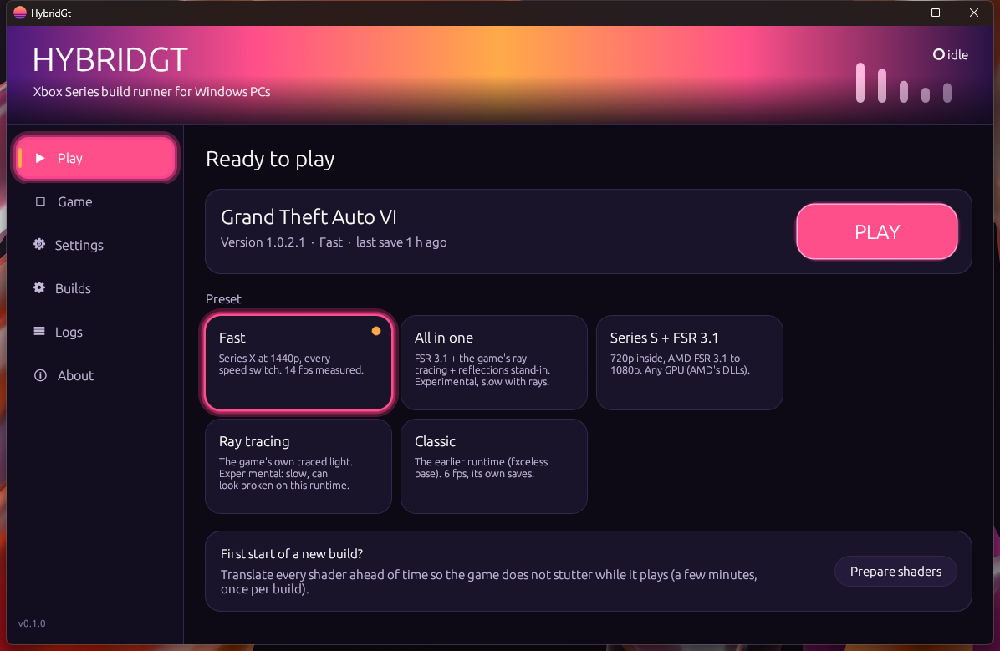

# About

Patches, tools and measurements for running the **Xbox Series X|S build of Grand Theft Auto VI on
Windows PCs**.

The game runs inside [victory-gta6](https://github.com/fxceless/victory-gta6), a fork of
[VIctory](https://github.com/Marvisak/VIctory): the console executable runs natively, its shaders
are translated to Direct3D 12, and its system calls are answered by the runtime. No emulator, no
virtual machine. HybridGt carries the patch on top of that fork, plus its own diagnostics.

[**Build and run**](docs/user/BUILD.md), [Status of every fix](docs/STATUS.md),
[Test runs and measurements](docs/PERFORMANCE_OPTIMIZATION.md),
[Known failures](docs/KNOWN_FAILURES.md), [Root causes](docs/ROOT_CAUSE_ANALYSIS.md),
[NVIDIA 32-lane waves](docs/NVIDIA_WAVE64_COMPATIBILITY.md), [Third-party code](THIRD_PARTY.md)

## Status

* Measured on one PC (Windows 11, RTX 4070 Ti 12 GB, Ryzen 7 5800X3D, 32 GB RAM). Percentages
are measured ratios where one exists (programs translated, frames a second); otherwise the
five-step scale of [STATUS.md](docs/STATUS.md), 20 % a step. The images are drawn by
`tools/make_status_images.py`.

**New base, 2.4x faster (HybridGt 0.2.0):** the runtime is now
[VIctory-NVIDIA](https://github.com/pepezin-ai/VIctory-NVIDIA) (pepezin-ai, on readmet3xt-lab's
[foxhound](https://github.com/readmet3xt-lab/foxhound)) with HybridGt's additions. On the test PC, same
route, back to back: **14.2 fps median** in the world (best 18.0), against 5.8 for the earlier runtime,
and **5.6 GB** of graphics memory against 9.2. Menus run at 30 fps.

## Launcher: one file

**[Download `HybridGt.exe`](https://github.com/LowBacon/HybridGt/releases/latest)**: the launcher with the
runtime inside. Start it and it finds your copy of the game, the runtime and your folders by itself
(a scan of your drives, about half a minute), then **PLAY**.

- **Presets:** Fast (the default: Series X at 1440p with every speed switch, 14 fps measured), All in
  one (AMD FSR 3.1 + the game's ray tracing, experimental), Series S + FSR 3.1 (any GPU), Ray tracing
  (experimental), and Classic (the earlier runtime, with its own saves).
- **Prepare shaders** translates every shader ahead of the first run, so the game does not stutter.
- **Live frame rate**, draws per frame and the log while the game runs; settings as switches; a
  build from source for those who want one.
- What it shows about the game is read from **your** folder (`MicrosoftGame.Config`); HybridGt
  carries nothing of the game. Source: [`crates/hgt-launcher`](crates/hgt-launcher).

## Compatibility

| Part of the game | State |
|---|---|
| Boot, menus, videos | Works, 30 fps |
| Intro and prologue | Renders, characters whole, 7-8 fps |
| Interiors | Lit by a stand-in for the game's traced light (`VICTORY_AMBIENT=1`) |
| Water | Renders; the light-volume shaders above and below the water are fixed offline, not yet seen in game |
| First boat mission | Boats float with fxceless's fix; mission not yet replayed with it |
| Ray tracing | The game's own builder runs, then the game crashes: off |
| AMD FSR 3.1 | **FSR 3.1.6** upscales 720p → 1080p in Series S mode (`--console series-s`) |
| Mouths | Move; trail the voice at low fps (`VICTORY_AUDIO_DELAY_MS` delays the sound to match, off) |
| Hair and faces | Soft: the game's 1440p → 4K temporal upscaler needs a higher frame rate |

## Input

Xbox controllers work as they are. Without one, the keyboard stands in:

| Key | Controller |
|---|---|
| Enter | A |
| Esc | Menu |
| W A S D | Left stick |

## Where the work comes from

Since 0.2.0 the runtime is **VIctory-NVIDIA** by pepezin-ai (trustno1-coder), built on **foxhound** by
readmet3xt-lab, with HybridGt's additions ([`patches/victory-nvidia`](patches/victory-nvidia)): chosen
by measurement on the same PC. The earlier runtime (the Classic preset) merges work from several
victory-gta6 forks:
[fxceless](https://github.com/fxceless/victory-gta6) (base), [ZTRX](https://github.com/Zettrox/ztrx),
DexNom, VIctory-7900XTX, VInAMD and cool_fox. Each piece was measured on this PC before it was kept;
the commits are listed in [`COMMITS.txt`](patches/victory-gta6-next3/COMMITS.txt).

| Folder | What is in it |
|---|---|
| [`patches/victory-gta6-next3/`](patches/victory-gta6-next3) | The current patch on victory-gta6 `f6a09d3b`, as one diff |
| [`tools/`](tools) | Launchers, log statistics, pipeline decoders, the status images |
| [`crates/`](crates) | A D3D12 diagnostic harness (`hgt-gfxdiag`) and texture code (`hgt-texture`) |
| [`docs/`](docs) | Every test run, measurement and root cause |

## Disclaimer

This project is for interoperability, research and compatibility purposes. It does not include,
distribute or require copyrighted game files, keys or proprietary libraries: you need **your own**
copy of the game, and you are responsible for obtaining and using it in line with the law and its
licence terms.

HybridGt is an independent project and is not affiliated with, authorized or endorsed by Rockstar
Games, Take-Two Interactive or Microsoft. "Grand Theft Auto" is a trademark of Take-Two
Interactive; "Xbox" is a trademark of Microsoft.

## License

GNU General Public License, version 3 or later, like VIctory and victory-gta6. XCL (GPL-2.0-only) was
studied as a reference only; no XCL code is used.
