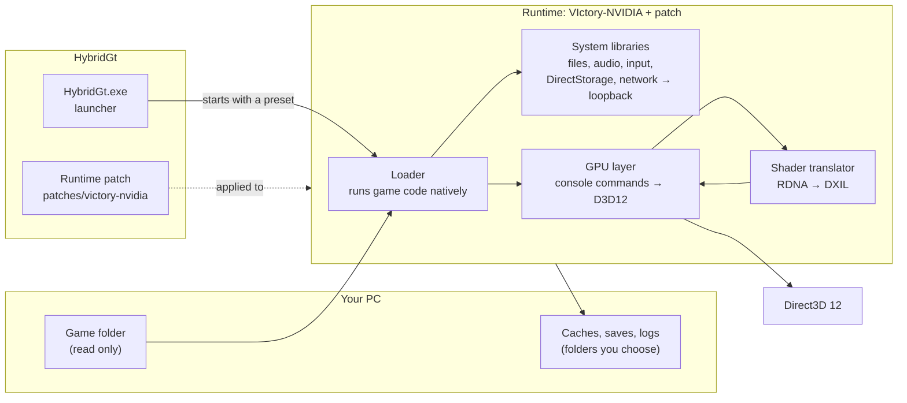
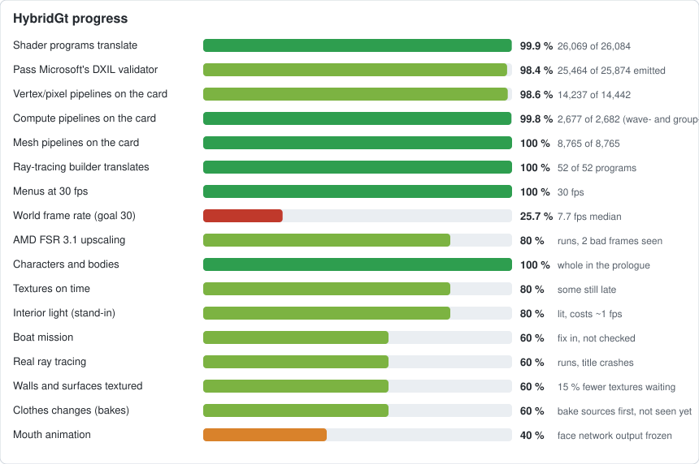
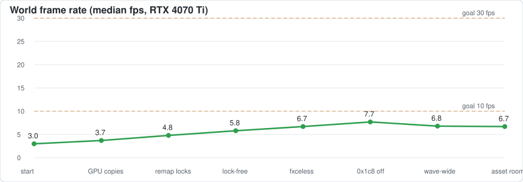

# HybridGt

A launcher, a runtime patch set and an open measurement record for running the **Xbox Series X|S
build of Grand Theft Auto VI on Windows PCs**, natively and offline, from your own copy of the game.

[](LICENSE)
[](docs/WINDOWS_COMPATIBILITY.md)
[](docs/dev/DEVELOPMENT.md)
[](docs/dev/SHADER_TRANSLATION.md)
[](docs/PERFORMANCE.md)
[](docs/PERFORMANCE.md#test-system)

[**Download**](https://github.com/LowBacon/HybridGt/releases/latest) ·
[Getting started](#getting-started) ·
[Architecture](docs/dev/ARCHITECTURE.md) ·
[Shader translation](docs/dev/SHADER_TRANSLATION.md) ·
[Performance](docs/PERFORMANCE.md) ·
[Known issues](docs/KNOWN_ISSUES.md) ·
[Troubleshooting](docs/user/TROUBLESHOOTING.md) ·
[Contributing](CONTRIBUTING.md) ·
[All documentation](docs/README.md)

> [!IMPORTANT]
> HybridGt contains no game files and never modifies, uploads or redistributes them. You need your own
> copy of the game's Xbox Series files. HybridGt doesn't bypass DRM, encryption or licensing.

## Contents

- [About](#about)
- [How it works](#how-it-works)
- [Development status](#development-status)
- [Performance](#performance)
- [Compatibility](#compatibility)
- [Getting started](#getting-started)
- [Documentation](#documentation)
- [Known limitations](#known-limitations)
- [Contributing](#contributing)
- [Credits](#credits)
- [Disclaimer and license](#disclaimer-and-license)

## About

Xbox Series consoles use an x86-64 AMD processor, the same kind of processor a PC has. So the game's
own machine code can run on a PC directly, without emulating a CPU. What a PC doesn't have is the
console's operating system and its GPU. A **runtime** fills that gap. It loads the game's executable,
answers its calls into the console's system libraries, and translates its graphics work, both
commands and shaders, to **Direct3D 12**.

HybridGt doesn't write that runtime from scratch. It builds on
[VIctory-NVIDIA](https://github.com/pepezin-ai/VIctory-NVIDIA) (pepezin-ai), which is built on
[foxhound](https://github.com/readmet3xt-lab/foxhound) (readmet3xt-lab), itself a fork of
[VIctory](https://github.com/Marvisak/VIctory) (Marvisak). HybridGt contributes three things:

| | |
|---|---|
| **The launcher** | `HybridGt.exe`, one file. It finds your game and the runtime, prepares shader and pipeline caches, starts the game with a tested preset, and reports problems in plain words. |
| **The runtime patch** | HybridGt's changes on top of VIctory-NVIDIA: AMD FSR 3.1 through the game's own calls, the mouth-animation fix, validator fixes, a sound delay, an offline shader test. Kept as one reviewable diff. |
| **The measurement record** | Every change is measured on a real PC before it is kept, including the ones that didn't help. Progress figures are counts or measurements, never estimates. |

**Scope today:** one game build (v1.0.2.1), Windows 10/11 x64, Direct3D 12 GPUs with mesh shaders.
Verified on NVIDIA; AMD is expected to work but hasn't been tested.

## How it works



| Component | Origin | Role |
|---|---|---|
| Loader, system libraries, GPU layer, shader translator | VIctory → foxhound → VIctory-NVIDIA (upstream) | Running the game: see [ARCHITECTURE.md](docs/dev/ARCHITECTURE.md#the-runtime) |
| FSR 3.1 module, sound delay, mouth fix, validator and LOD fixes, heap-descriptor reads, offline tests | **HybridGt** patch | See [What the HybridGt patch changes](docs/dev/ARCHITECTURE.md#what-the-hybridgt-patch-changes) |
| Launcher | **HybridGt** | Setup, presets, diagnostics: see [LAUNCHER.md](docs/LAUNCHER.md) |

Most of the work per frame isn't the GPU's. A console's CPU and GPU share one memory, while a PC has
two, so the runtime spends most of each frame keeping copies of the game's memory on the graphics
card. That is why the frame rate is CPU-bound today ([PERFORMANCE.md](docs/PERFORMANCE.md)).

## Development status

<sub>Every figure below is a count from an offline run or a measurement from a game session on the
[test system](docs/PERFORMANCE.md#test-system). Items marked *earlier runtime* were measured before
the move to VIctory-NVIDIA.</sub>

[](docs/STATUS.md)

**Runtime:** VIctory-NVIDIA `9d6300fa` plus the HybridGt patch, the default since 0.2.0. The earlier
runtime remains available as the *Classic* preset.

**Shader translation** (offline, 2026-11-27, for a 32-lane NVIDIA GPU):

| Stage | Programs | Pass Microsoft's DXIL validator |
|---|---:|---:|
| Vertex and pixel | 14,247 | **14,247 (100 %)** |
| Mesh | 8,765 | 8,694 (99.2 %) |
| Compute | 2,682 | 2,659 (99.1 %) |
| Geometry | 195 | 0 |
| **All** | **25,889** | **25,600 (98.9 %)** |

The remaining 289 programs, why each fails and what it takes, are listed in
[SHADER_TRANSLATION.md](docs/dev/SHADER_TRANSLATION.md#what-is-left-and-why).

**Milestones:**

| Date | Milestone |
|---|---|
| 2026-11-24 | First 3D world on an RTX 4070 Ti (0.4 fps) |
| 2026-11-26 | Whole characters, lit interiors, AMD FSR 3.1.6 in game (earlier runtime) |
| 2026-11-27 | Runtime moved to VIctory-NVIDIA: **14.2 fps median**, 5.6 GB graphics memory |
| 2026-11-27 | Every vertex and pixel program passes Microsoft's validator; launcher 0.3.0 built and tested offline |

Every problem's progress, from *found* to *seen fixed in game*, is tracked in
[STATUS.md](docs/STATUS.md). What comes next is in [ROADMAP.md](docs/ROADMAP.md).

## Performance

Measured on an RTX 4070 Ti 12 GB, Ryzen 7 5800X3D and 32 GB RAM, Windows 11. Both runtimes ran the same
scripted open-world route back to back, with caches warmed. The game rendered at 1440p and upscaled
to 4K with its own temporal upscaler.

| Runtime | Median fps | Best | 10th percentile | Median frame time | Graphics memory |
|---|---:|---:|---:|---:|---:|
| Earlier runtime (now *Classic*) | 5.8 | 7.4 | 1.9 | 174 ms | 9.2 GB |
| **VIctory-NVIDIA + HybridGt (default)** | **14.2** | **18.0** | **3.5** | **70 ms** | **5.6 GB** |

[](docs/PERFORMANCE_OPTIMIZATION.md)

- **Median fps** is the typical speed: half the measured seconds were faster.
- **10th percentile** is the speed the slowest tenth of seconds stayed under. True 1 % lows weren't
  measured, because the runtime logs once a second.
- Menus and videos run at the game's own 30 fps.
- **The bottleneck is the CPU side:** copying and checking the game's memory for the GPU, not the GPU itself.

**Not yet measured:** FSR 3.1 and DLSS on the current runtime, the launcher's memory modes and frame
caps, AMD GPUs. **Target:** 30 fps in the world. Method, frame breakdown and how to report a benchmark:
[PERFORMANCE.md](docs/PERFORMANCE.md).

## Compatibility

| Category | Meaning |
|---|---|
| **Verified** | Seen working in a game session on the test system |
| **Partially working** | Works, with a visible flaw |
| **Experimental** | Available behind a preset or switch, not verified on the current runtime |
| **Not implemented** | No path exists yet |
| **Known issue** | Reproducible problem under investigation |

| Area | State | Notes |
|---|---|---|
| Boot, menus, videos | Verified | 30 fps |
| Open world | Verified | 14.2 fps median |
| Characters, interiors | Verified | Interiors use an estimate of the game's traced light |
| Saves | Verified | One saves folder per runtime |
| Boats, first boat mission | Verified (earlier runtime) | Seen by the tester on the Classic runtime; not yet replayed on the current one |
| Cutscenes | Partially working | Eyes and close-ups can look wrong while textures load |
| Textures | Partially working | Some arrive late or re-upload: [KNOWN_ISSUES.md](docs/KNOWN_ISSUES.md#rendering) |
| Mouth animation | Partially working | The #927 fix was seen working on the earlier runtime. On the current runtime it is ported but not yet seen, and mouths trail the voice at low fps (Settings → Sound delay). |
| Water | Known issue | Dark pixels |
| AMD FSR 3.1 | Experimental | Verified on the earlier runtime (FSR 3.1.6); ported, not yet run |
| The game's ray tracing | Experimental | Ray tracing and All in one presets |
| NVIDIA DLSS | Experimental | Base runtime support; not measured by HybridGt |
| Voxelized lighting (geometry stage) | Not implemented | 195 programs |
| Xbox controllers, keyboard | Verified | Keyboard: Enter = A, Esc = Menu, W A S D = left stick |
| NVIDIA RTX 40 | Verified | RTX 4070 Ti |
| AMD Radeon | Not verified | Expected to work; see [WINDOWS_COMPATIBILITY.md](docs/WINDOWS_COMPATIBILITY.md#graphics-cards) |

**How compatibility is tested:**
- *Offline*: every shader is translated and validated, and the unit and GPU tests are run (WARP, the
  software renderer, and the hardware GPU).
- *In game*: sessions on the test system follow a fixed route, and a tester reports what is seen.
- An item is *Verified* only after a game session. Offline results alone stay *Experimental*.

## Getting started

### Requirements

| | |
|---|---|
| OS | Windows 10 version 2004 (build 19041) or later, x64. Tested on Windows 11. |
| GPU | Direct3D 12 with mesh shaders and Shader Model 6.6, 8 GB or more. Tested: RTX 4070 Ti 12 GB. |
| RAM | 32 GB recommended (tested) |
| Disk | About 20 GB free for shader and pipeline caches, preferably on an SSD |
| Libraries | Microsoft Visual C++ 2015–2022 Redistributable (x64) |

Details: [WINDOWS_COMPATIBILITY.md](docs/WINDOWS_COMPATIBILITY.md).

### Using the release

1. Download `HybridGt.exe` from [Releases](https://github.com/LowBacon/HybridGt/releases/latest) into
   a folder of its own. Settings are saved beside it.
2. Start it. It scans your drives for the game folder, the runtime, caches and saves (about half a
   minute). You can also set them under **Settings**.
3. Open **Diagnostics** and check that every requirement reads *ok* or *optional*.
4. On **Home**, press **INITIALIZE**. It runs eight steps (dependencies, game files, configuration,
   shader cache, pipeline cache, assets, compatibility, integrity), each with its result and reason.
5. Press **PLAY**. After your first session, run INITIALIZE again so the pipeline step makes the
   recorded pipelines ahead of time.

### Building from source

```powershell
git clone https://github.com/LowBacon/HybridGt
cd HybridGt
cargo build --release -p hgt-launcher
```

```powershell
cargo test --release -p hgt-launcher
```

These need the Rust MSVC toolchain (1.88+) and the Windows SDK. The runtime is built from VIctory-NVIDIA
`9d6300fa` with `patches/victory-nvidia` applied. Every step, every test command and the offline shader
check are in [DEVELOPMENT.md](docs/dev/DEVELOPMENT.md).

### Configuration

The launcher passes folders and switches to the runtime as environment variables, so nothing is
written into the game folder. NVIDIA's DLSS files and AMD's FSR 3 files aren't included. Run
`tools\vendor\Get-NVIDIA-DLSS.cmd` or `Get-AMD-FSR.cmd` once to fetch them from the vendors' own
GitHub, and the launcher's scan finds them ([details](tools/vendor/README.md)). Presets and settings are documented in [LAUNCHER.md](docs/LAUNCHER.md).
Memory modes are explained in [GPU_MEMORY.md](docs/GPU_MEMORY.md).

| Preset | Inside resolution | Upscaling | Status |
|---|---|---|---|
| **Fast** (default) | 1440p (Series X profile) | The game's own | Measured: 14.2 fps median |
| Performance | 1440p (Series X profile) | DLSS Quality and frame generation 2x, with [NVIDIA's files](tools/vendor) | New: upstream's measured worker-pool tuning (+22–29 % in heavy scenes on an RTX 4070 SUPER), High priority. Not yet measured here |
| Series S + FSR 3.1 | 720p (Series S profile) | AMD FSR 3.1 → 1080p | Experimental on this runtime |
| All in one | 720p (Series S profile) | AMD FSR 3.1 | Experimental: adds the game's ray tracing |
| Ray tracing | 1440p (Series X profile) | The game's own | Experimental |
| Classic | The game's choice | The game's own | The earlier runtime, with its own saves |

### Troubleshooting

The launcher's **Diagnostics** page is the first stop. Common cases (a black first run, saves that
don't load, a blocked setup step, memory pressure, mouths out of sync) are covered in
[TROUBLESHOOTING.md](docs/user/TROUBLESHOOTING.md).

> [!NOTE]
> Game-specific setup stays on your machine. Where your copy comes from, and your right to use it, is
> your responsibility. HybridGt's documentation only refers to the folder you point it to.

## Documentation

| For | Documents |
|---|---|
| Players | [Troubleshooting](docs/user/TROUBLESHOOTING.md) · [Launcher](docs/LAUNCHER.md) · [Windows compatibility](docs/WINDOWS_COMPATIBILITY.md) · [GPU memory](docs/GPU_MEMORY.md) · [Known issues](docs/KNOWN_ISSUES.md) |
| Developers | [Architecture](docs/dev/ARCHITECTURE.md) · [Shader translation](docs/dev/SHADER_TRANSLATION.md) · [Development](docs/dev/DEVELOPMENT.md) · [NVIDIA and 64-lane waves](docs/NVIDIA_WAVE64_COMPATIBILITY.md) · [Contributing](CONTRIBUTING.md) |
| Status | [Performance](docs/PERFORMANCE.md) · [Status of every fix](docs/STATUS.md) · [Roadmap](docs/ROADMAP.md) · [Run log](docs/PERFORMANCE_OPTIMIZATION.md) · [Changelog](CHANGELOG.md) |

The full index is in [docs/README.md](docs/README.md).

## Known limitations

- **Frame rate.** About 14 fps in the open world, bound by the CPU-side copies of game memory. The
  target is 30.
- **Rendering.** Textures can arrive late or in the wrong colour. Some descriptor views past Direct3D
  12's 1,000,000-view cap read an empty slot, a likely cause of wrong-looking eyes. Water has dark
  pixels.
- **Shaders.** 195 geometry programs, 71 oversized mesh programs and 23 compute programs that need
  64-lane waves don't run yet ([details](docs/dev/SHADER_TRANSLATION.md#what-is-left-and-why)).
- **Memory.** The texture cache fills most of the graphics card by design. RAM pressure appears on 32 GB.
- **Hardware.** Verified on one NVIDIA card. AMD and Intel are untested. GPUs without mesh shaders
  can't run the game.
- **Unverified on the current runtime:** FSR 3.1, DLSS, ray tracing, the memory modes and the frame
  caps. Launcher 0.3.0 is built and unit-tested, but its interface hasn't been seen running.

Everything under investigation, with its evidence, is in [KNOWN_ISSUES.md](docs/KNOWN_ISSUES.md).

## Contributing

Bug reports, benchmarks (especially on AMD), shader work and documentation fixes are welcome. Please
read [CONTRIBUTING.md](CONTRIBUTING.md) first. It covers the development environment, testing
expectations, how to report a benchmark, and the one absolute rule: **no game files or anything
derived from them, ever**.

## Credits

| Project | Author | Used for |
|---|---|---|
| [VIctory-NVIDIA](https://github.com/pepezin-ai/VIctory-NVIDIA) | pepezin-ai (trustno1-coder) | The runtime since 0.2.0 |
| [foxhound](https://github.com/readmet3xt-lab/foxhound) | readmet3xt-lab | VIctory-NVIDIA's base |
| [VIctory](https://github.com/Marvisak/VIctory) | Marvisak | The original runtime |
| [victory-gta6](https://github.com/fxceless/victory-gta6) | fxceless | The Classic runtime; the boat fix; the mouth fix #927 by tippythetaidum |
| [ZTRX](https://github.com/Zettrox/ztrx) and other forks | ZTRX contributors, DexNom, VIctory-7900XTX, VInAMD, cool_fox | Merged into the Classic runtime |
| AMD FidelityFX API | AMD (MIT) | The FSR 3.1 interface. AMD's signed DLLs are loaded at run time, not included. |

Every merged commit keeps its author. The full list with licences is in [THIRD_PARTY.md](THIRD_PARTY.md).

## Disclaimer and license

HybridGt is an independent interoperability and research project. It is not affiliated with, authorized
or endorsed by Rockstar Games, Take-Two Interactive, Microsoft, AMD or NVIDIA. "Grand Theft Auto" is a
trademark of Take-Two Interactive and "Xbox" is a trademark of Microsoft. Other names belong to their
owners. The repository contains no game code, assets, keys or proprietary libraries. Third-party
components keep their own licences, listed in [THIRD_PARTY.md](THIRD_PARTY.md).

HybridGt is licensed under the [GNU General Public License, version 3 or later](LICENSE), like VIctory
and the runtimes built on it. XCL (GPL-2.0-only) was studied as a reference only, and none of its code
is used.
