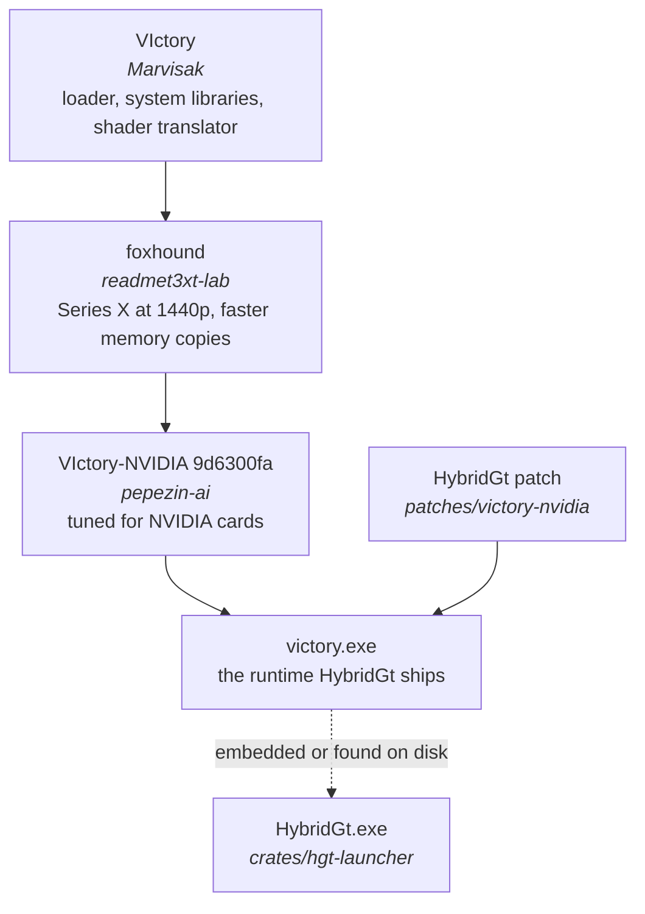
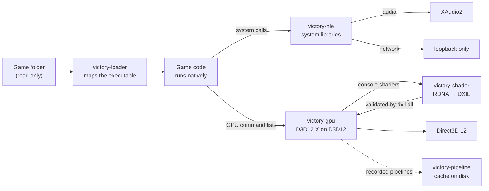

# Architecture

[← README](../../README.md) · [Shader translation](SHADER_TRANSLATION.md) · [Development](DEVELOPMENT.md)

HybridGt has two parts. The **runtime** loads the game's own executable and runs it, and the **launcher**
prepares and starts that runtime. The runtime is not written from scratch: it is an upstream project
with HybridGt's changes applied as a patch.

## Where the code comes from

| Layer | Owner | What it is |
|---|---|---|
| VIctory | Marvisak, upstream | The original runtime: loader, system libraries, GPU command and shader translation |
| foxhound | readmet3xt-lab | A fork of VIctory: Series X at native 1440p, and memory copies about twice as fast |
| VIctory-NVIDIA | pepezin-ai (trustno1-coder) | A fork of foxhound tuned for NVIDIA. HybridGt's base since 0.2.0, pinned at `9d6300fa` |
| HybridGt patch | This repository | Everything HybridGt adds to that base, as one diff: [`patches/victory-nvidia`](../../patches/victory-nvidia) |
| Launcher | This repository | `HybridGt.exe`: [`crates/hgt-launcher`](../../crates/hgt-launcher) |

The earlier runtime, built on fxceless's victory-gta6, is kept as the launcher's *Classic* preset. Its
patch is in [`patches/victory-gta6-next3`](../../patches/victory-gta6-next3).

## The runtime

The console's processor is an AMD Zen 2, so the game's x86-64 machine code runs as it is. What differs
is everything around it: the operating system, the system libraries, and the GPU.

| Crate | Role |
|---|---|
| `victory-pe` | Reads PE32+ images and import libraries. It only reads; it never patches. |
| `victory-loader` | Maps the title into the process, resolves its imports, and places the hooks the title needs. |
| `victory-hle` | The Xbox system API: files, threads, memory, input, audio through XAudio2, DirectStorage, FidelityFX. Its network module refuses everything but loopback. |
| `victory-gpu` | D3D12.X on host D3D12. Every command the title records arrives as a call and is replayed on the host: copies of title memory, descriptor heaps, indirect draws clamped to a budget, texture uploads. |
| `victory-shader` | Console shaders to host shaders: decodes GFX10 (RDNA) machine code, raises it to an intermediate form, lowers it to DXIL. See [SHADER_TRANSLATION.md](SHADER_TRANSLATION.md). |
| `victory-pipeline` | Offline conversion of the user's data into the user's cache: translated shaders and the record of pipelines a session used. |
| `victory-formats` | Pure data formats: the GPU's tiled texture layouts, and planned BCPack and audio codecs. |
| `victory-game` | What is specific to this title: container formats, build identities, hook signatures. |
| `victory-core` | Configuration, logging, and the policy that refuses to write game-derived data into the source tree. |
| `apps/victory` | The command line: `run`, `shaders`, `warm`, `translate`, `shader-info` and diagnostics. |

### One frame, simplified

1. The game's render thread records command lists through D3D12.X. In the console's API, most commands
   are written inline as packets. The runtime keeps the packet limits at zero, so every command
   becomes a call it handles.
2. `victory-gpu` finds what each draw reads and writes, in title memory and in descriptor heaps, and
   makes sure a copy is on the card. On a console the CPU and GPU share one memory. On a PC they have
   two, and keeping them in step is most of the runtime's cost (see [PERFORMANCE.md](../PERFORMANCE.md)).
3. Each new shader is translated once and cached. Each new pipeline (shaders plus state) is made once.
   Pipelines that a previous session recorded can be made ahead of time with `victory warm`.
4. The lists run on the host's Direct3D 12 queue, and what shaders wrote is copied back into title memory.

### Why 32-lane GPUs need extra work

Console shaders were compiled for 64-lane waves (wave64), and many use cross-lane operations such as
ballots, lane counts and reading another lane. NVIDIA GPUs run 32-lane waves. The translator rewrites
such programs so that two 32-lane waves give the console's answer. For a few programs it can't yet do
this exactly. Details: [NVIDIA_WAVE64_COMPATIBILITY.md](../NVIDIA_WAVE64_COMPATIBILITY.md) and
[SHADER_TRANSLATION.md](SHADER_TRANSLATION.md).

## What the HybridGt patch changes

The patch is `git diff 9d6300fa HEAD` of HybridGt's branch. Its commits are listed in
[`COMMITS.txt`](../../patches/victory-nvidia/COMMITS.txt).

| Area | Change | Switch |
|---|---|---|
| AMD FidelityFX | The game's FSR 3.1 calls run AMD's PC upscaler on the host device. AMD's messages go to the runtime's log. | `VICTORY_FFX_DIR`, `VICTORY_FFX_DEBUG` |
| Audio | A delay line on XAudio2's mastering voice, so speech can wait for late mouths | `VICTORY_AUDIO_DELAY_MS` (off) |
| Mouths | fxceless #927 (tippythetaidum): 16-bit face-network values moved bit-exactly through unsigned twin views | always on |
| Validator | Signature parts ordered as the validator builds them; one interpolation mode per signature row | always on |
| Texture LOD queries | A texture array's slice is no longer passed as a coordinate of `calculateLOD` | always on |
| Ray-traced shadows | A heap descriptor read only for its address is read from title memory at the heap's address | `VICTORY_HEAP_DESC_MEMORY` (on; `0` refuses as before) |
| Tests | An offline translate-and-validate test and a shader disassembly test. Two indirect-budget tests and one 16-bit test brought up to date with the base. | `VICTORY_TEST_SHADERS` |

## The launcher

`crates/hgt-launcher` is a native Windows program written in Rust with egui (`eframe` on OpenGL
through `glow`). It has no network dependencies.

| Module | Role |
|---|---|
| `main.rs` | Window, navigation, starting and watching processes, playtime |
| `pages.rs`, `style.rs` | The five pages and the visual style |
| `config.rs` | Settings in `hybridgt-launcher.json` (beside the executable, or `%LOCALAPPDATA%\HybridGt`) |
| `scan.rs` | Finds the game folder, runtimes, caches, saves and FidelityFX DLLs on the PC's drives |
| `system.rs`, `deps.rs` | Reads this PC (registry and Win32) and checks the runtime's requirements |
| `library.rs` | Reads the game's name, version and art from its own `MicrosoftGame.Config`, and keeps playtime |
| `setup.rs` | INITIALIZE: eight steps with real progress, and a report |
| `jobs.rs` | Runs `victory run`, `shaders`, `warm` and `cargo build` without a window, and follows their output |
| `presets.rs` | Each preset's switches, plus the settings, as environment variables for the runtime |
| `diagnostics.rs` | Summarizes the newest log |
| `offline.rs` | The offline policy, and tests that fail the build if network code appears |
| `mark.rs`, `build.rs` | HybridGt's mark, drawn as pixels: the window icon and the `.ico` and version resource in the executable |

The launcher never writes into the game folder. It passes folders to the runtime as environment
variables (`VICTORY_GAME_DIR`, `VICTORY_CACHE_DIR`, `VICTORY_DATA_DIR`), and it clears any `VICTORY_*`
variable it inherited, so the preset is exactly what runs.
