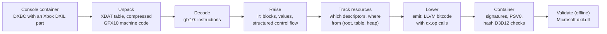

# Shader translation

[← README](../../README.md) · [Architecture](ARCHITECTURE.md) · [Development](DEVELOPMENT.md)

The game ships its GPU programs compiled for the console's AMD RDNA GPU. The runtime translates each
one into DXIL, the format Direct3D 12 runs, the first time it is needed, and caches the result. This
page explains how that works, how it is measured, and what doesn't translate yet.

## The pipeline of one program



| Stage | Module (`victory-shader`) | What can stop a program here |
|---|---|---|
| Unpack | `dxbc`, `dxil`, `native` | A container with no native code |
| Decode | `gfx10` | An instruction the decoder doesn't know |
| Raise | `ir`, `structure` | Control flow that can't be structured |
| Track resources | `resource` | A descriptor address with no known source, for example *"an address in an SGPR that is no root parameter"* |
| Lower | `emit::lower` | An operation with no DXIL form yet, for example *"no wave32 lowering for this wave64 program"* |
| Validate | `emit::validator` | DXIL that Microsoft's validator rejects, for example mesh outputs over 32 KB |

**Validation** is the strictest check available without running the game. `dxil.dll` is the same
validator Microsoft's own compiler uses. A program that passes is well-formed DXIL by Microsoft's
rules. Passing doesn't prove the program computes the same image as the console. Only the game, and
the runtime's GPU unit tests, can show that.

## Current results

Measured offline on 2026-11-27, on the current runtime (VIctory-NVIDIA `9d6300fa` plus the HybridGt
patch), as for a 32-lane NVIDIA GPU:

| Stage | Programs | Translated | Pass the validator | Share passing |
|---|---:|---:|---:|---:|
| Vertex and pixel | 14,247 | 14,247 | **14,247** | **100 %** |
| Mesh | 8,765 | 8,765 | 8,694 | 99.2 % |
| Compute | 2,682 | 2,659 | 2,659 | 99.1 % |
| Geometry | 195 | 0 | 0 | 0 % |
| **All** | **25,889** | **25,671** | **25,600** | **98.9 %** |

Of the programs that translate, **99.7 %** pass the validator.

<sub>"Programs" counts the native programs found in the game's `shaders.rpf` for the stages the
translator handles, each container once. The full log of a run lists every program with its result.</sub>

## What is left, and why

| Programs | Where | Cause | What it takes |
|---:|---|---|---|
| 195 | Geometry: `GS_VoxelizeGeneric` (voxelization for lighting) | Each reads a pointer from `s[8:9]`, a console driver table that holds ring-buffer offsets. The runtime doesn't build that table. | A geometry stage: emulate the console's geometry rings, or turn the voxelizer into a compute or mesh program |
| 71 | Mesh: characters on fire, decals, spatter (`MS*_VS_*Fire*`, `*_Decals`, `*Spatter*`) | 79 output values × 128 vertices × 4 bytes = 40,448 bytes, over Direct3D 12's 32,768 per group, even at the lane count | Pack two 16-bit values per 32-bit output and interpolate them in the pixel shader, or split each 128-vertex group in two. See [the two approaches ruled out](#mesh-programs-over-32-kb-what-was-ruled-out). |
| 22 | Compute: particle emitters, decal trails, triangle collection, hair shadow masks, water volumetrics | They use lane counts and ballots over all 64 lanes as data. Every existing 64-on-32 strategy refuses them as inexact. | Emulate a 64-lane wave through group-shared memory for these programs |
| 1 | Compute: `CS_TraceShadowRays_FullAdaptive` | A lane mask holding lanes outside the running set, read as data | Part of the same 64-lane work |

Earlier fixes, with the count they moved:

| Fix | Programs |
|---|---:|
| Signature parts in the order the validator builds them | 78 (counted on the earlier runtime) |
| One interpolation mode per signature row | 43 |
| Level-of-detail query: a texture array's slice is no coordinate (`calculateLOD`) | 3 |
| Bindless-heap descriptor read only for its address, now read from title memory | 4 |

## Mesh programs over 32 KB: what was ruled out

Both were checked offline on 2026-11-27:

| Idea | Result |
|---|---|
| Declare the outputs 16-bit | Microsoft's validator counts a 16-bit output as 4 bytes too. Two test mesh shaders compiled with `dxc` (17 four-component outputs, 128 vertices) fail alike as `float` and `float16_t`. |
| Leave out outputs the pixel shader never reads, per pipeline | 50 of the 71 programs appear in pipelines recorded in game sessions (85 mesh-plus-pixel pairs). In every pair the pixel shader reads **all 19** of the mesh program's arbitrary outputs, so nothing can be left out. |

What remains is to cut the bytes per vertex, by keeping 16-bit values packed two per 32-bit output and
interpolating them in the pixel shader, or to cut the vertices per group by splitting each console
group across two host groups. NVIDIA's driver already builds and runs these programs as they are.
Only the validator refuses them.

## Checking it yourself

The translator and validator run from a test, without starting the game or creating a graphics
device. In the VIctory-NVIDIA checkout with the HybridGt patch:

```powershell
$env:VICTORY_TEST_SHADERS = 'D:\Games\GTA6-Xbox\shaders.rpf'
$env:VICTORY_TEST_WAVE = '32'
$env:VICTORY_TEST_VIEWS = '999999'
```

```powershell
cargo test --release -p victory every_shader -- --ignored --nocapture
```

| Variable | Meaning |
|---|---|
| `VICTORY_TEST_SHADERS` | The game's `shaders.rpf` (read only) |
| `VICTORY_TEST_WAVE` | `32` for NVIDIA and Intel. Leave it unset for AMD, which can run 64-lane waves. |
| `VICTORY_TEST_VIEWS` | The host's view heap limit, `999999` (Direct3D 12's 1,000,000 less the null slot) |
| `VICTORY_TEST_JOBS` | Threads (default 4) |
| `VICTORY_TRANSLATE_ONLY` | Comma-separated hash prefixes: translate only those programs |
| `VICTORY_EMIT_DUMP` | A folder **outside the repository** for the emitted DXIL and validator reports. The runtime refuses a folder inside it, because the output is game-derived. |

To see a program's machine code:

```powershell
$env:VICTORY_TEST_ONLY = 'dbdbf36298727135'
```

```powershell
cargo test --release -p victory disassemble_chosen -- --ignored --nocapture
```

The output prints the program's stage, root layout, used resources and disassembly. It writes nothing
to disk. Shader dumps and disassembly are derived from the game, so keep them out of commits and
issues.
